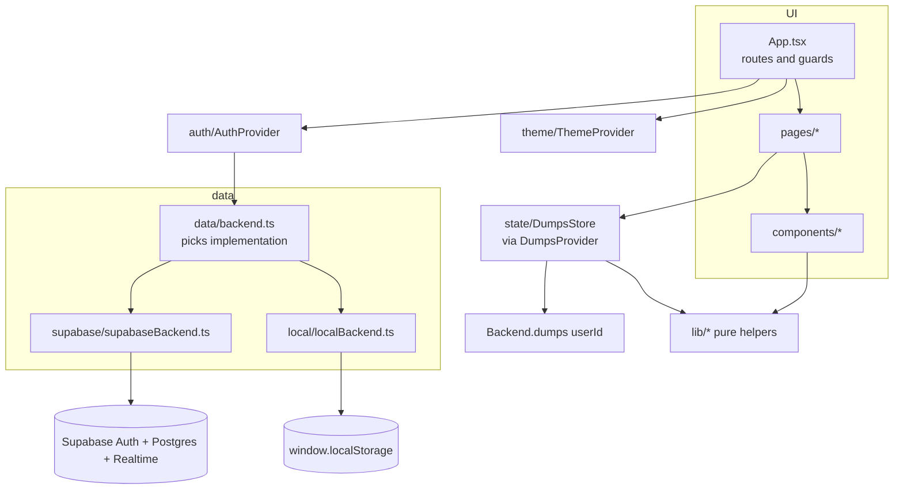

# Mind Dump: Design

> Companion docs: [README.md](README.md) (setup and deploy, user-facing) · [FLOW.md](FLOW.md) (code flow, entry to exit).

## 1. What it is

Mind Dump is a single-page web app for emptying your head. Each thought you type becomes a **tile** on a board, and every tile shows how many days it has been waiting. Clicking a tile means "handled": it moves to **History**, where you can restore it or delete it for good. It is built for individuals who want a low-friction, private place to capture loose thoughts and to-dos on phone and desktop.

### Main features

| Feature | Where it lives |
|---|---|
| Add a dump (Enter), or split a pasted list into one tile per line ("Split into N", Ctrl/Cmd+Enter) | [src/components/Composer.tsx](src/components/Composer.tsx), [src/lib/text.ts](src/lib/text.ts) |
| Click a tile to clear it, with an animated exit and an **Undo** toast | [src/pages/BoardPage.tsx](src/pages/BoardPage.tsx) |
| "Days pending" badge whose colour warms with age (fresh, then 3d, 7d, 14d+) | [src/components/DumpCard.tsx](src/components/DumpCard.tsx), [src/lib/days.ts](src/lib/days.ts) |
| Drag and drop reorder (mouse, touch long-press, keyboard via the grip handle) | [src/components/DumpGrid.tsx](src/components/DumpGrid.tsx) |
| Sort modes (My order, Newest, Oldest, A→Z, Z→A, Shortest, Longest) and search | [src/lib/sort.ts](src/lib/sort.ts), [src/pages/BoardPage.tsx](src/pages/BoardPage.tsx) |
| Edit dialog: edit text, delete, Move to top/bottom (a non-drag way to reorder) | [src/components/EditDumpDialog.tsx](src/components/EditDumpDialog.tsx) |
| History grouped by day, with search, restore, delete forever, clear all and "Load more" paging | [src/pages/HistoryPage.tsx](src/pages/HistoryPage.tsx) |
| Email and password accounts: sign up, sign in, forgot/reset password | [src/pages/AuthPages.tsx](src/pages/AuthPages.tsx), [src/auth/AuthProvider.tsx](src/auth/AuthProvider.tsx) |
| Cloud mode (Supabase, with live sync between devices) **or** device-only mode (localStorage) | [src/data/](src/data/) |
| Light, dark and auto themes, with no flash of the wrong theme on load | [index.html](index.html), [src/theme/ThemeProvider.tsx](src/theme/ThemeProvider.tsx) |
| Keyboard shortcuts: `n` or `/` focuses the composer | [src/pages/BoardPage.tsx](src/pages/BoardPage.tsx) |
| Installable web app manifest | [public/manifest.webmanifest](public/manifest.webmanifest) |

## 2. Tech stack

| Tech | Used for | Likely reason |
|---|---|---|
| **React 19** + **TypeScript** (strict) | UI | Uses `useSyncExternalStore` for the store. Strict TS (`noUnusedLocals` and similar) catches mistakes at build time. |
| **Vite 8** | Dev server and bundler | Fast HMR. `base` comes from `VITE_BASE`, so one build can target a sub-path host such as GitHub Pages. |
| **Tailwind CSS v4** (`@tailwindcss/vite`) | Styling | Utility classes plus semantic colour tokens (`bg-card`, `text-ink`) defined once in [src/index.css](src/index.css) and switched per theme. |
| **react-router v7** | Routing (`/`, `/history`, `/login`, `/signup`, `/forgot-password`, `/reset-password`) | Declarative route guards, and `basename` for sub-path deploys. |
| **@dnd-kit** (core, sortable, utilities) | Drag reorder | Accessible: keyboard sensor, screen-reader announcements, touch sensor with long-press. |
| **@supabase/supabase-js** | Auth, Postgres, Realtime | Free hosted backend. Row-level security lets the anon key be public. |
| **sonner** | Toasts (errors, Undo, confirmations) | Toasts with action buttons; theme-aware. |
| **lucide-react** | Icons | |
| **clsx** (re-exported as `cn`) | Conditional class names | [src/lib/cn.ts](src/lib/cn.ts) |
| **Vitest** | Unit tests for pure logic and the store | Shares config with Vite ([vite.config.ts](vite.config.ts)). |
| **Playwright** | End-to-end tests (desktop and mobile projects) | Runs against device-only mode, so no network backend is needed. |

There is no ESLint config or dependency in the repo, although two files contain `eslint-disable` comments.

## 3. Architecture

The code is layered, and dependencies point one way: UI (`App`, `pages/`, `components/`) → `state/`, `auth/`, `theme/`, `hooks/` → `data/` → `lib/` and `domain/`. Nothing in `data/`, `lib/` or `domain/` imports React components (`lib/` and `data/types.ts` do import `domain/` types, and `data/types.ts` imports `PositionUpdate` from `lib/position.ts`).

```
src/
  main.tsx, App.tsx   entry, providers, routes and guards
  pages/              screens: BoardPage, HistoryPage, AuthPages
  components/         presentational and interactive pieces (DumpGrid, DumpCard, Composer, dialogs, ui kit)
  state/              DumpsStore (client source of truth) + React binding (DumpsProvider)
  auth/               AuthProvider: current user, ready flag, recovery flag
  theme/              ThemeProvider: light/dark/system preference
  hooks/              useNow (ticking clock), usePersistentState (localStorage-backed state)
  data/               Backend interface + two implementations (supabase/, local/), error mapping
  domain/             plain types: Dump, AppUser, MAX_DUMP_LENGTH, initialsOf
  lib/                pure functions: days, sorting, fractional positions, text, ids
supabase/migrations/  SQL schema, RLS policies, triggers, RPC
e2e/                  Playwright tests (device-only mode)
e2e-cloud/            Playwright smoke test against a real Supabase project (run manually)
```



### Boundaries and responsibilities

- **`data/types.ts` is the contract.** `Backend` exposes `kind`, `auth: AuthApi` and `dumps(userId): DumpsApi`. Nothing above `data/` knows whether Supabase or localStorage is underneath. The only exception is `backendKind`, which the UI uses for banners and labels.
- **`data/backend.ts`** creates the single app-wide backend when the module loads. It uses Supabase if both `VITE_SUPABASE_URL` and `VITE_SUPABASE_ANON_KEY` are set (non-empty after trimming), and otherwise `createLocalBackend(window.localStorage)`.
- **`state/dumpsStore.ts`** is a framework-agnostic class that owns all dump state for one user. It handles optimistic updates, rollback, per-item request ordering, refresh debouncing and history paging. React reads it through `useSyncExternalStore` in [src/state/DumpsProvider.tsx](src/state/DumpsProvider.tsx). Pages call store methods; they never call the backend directly for dumps.
- **`auth/AuthProvider.tsx`** wraps `backend.auth`. Auth pages call `auth.signIn` and similar methods directly. User state changes **only** through the `onChange` listener, never from a method's return value.
- **`lib/`** holds pure functions with no React or I/O. It is unit-tested in [src/lib/lib.test.ts](src/lib/lib.test.ts).
- **`components/ui.tsx`** is the small in-house UI kit: `Button`/`buttonClass`, `TextField`, `PasswordField`, `Modal` (native `<dialog>`), `ConfirmDialog`, `EmptyState`, `Splash`, `Logo`, `LogoMark`, `Kbd` and `focusRing`.

## 4. Data model and storage

### Domain types ([src/domain/](src/domain/))

```ts
type DumpStatus = 'active' | 'done'
interface Dump {
  id: string            // UUID v4, generated on the client (lib/id.ts)
  content: string       // trimmed, max 5000 chars (MAX_DUMP_LENGTH)
  position: number      // fractional ordering key, ascending ("My order")
  status: DumpStatus
  createdAt: string     // ISO; drives "days pending"
  updatedAt: string
  completedAt: string | null
}
interface AppUser { id: string; email: string; displayName: string }
```

### Where data lives

| Data | Cloud mode | Device-only mode |
|---|---|---|
| Accounts / sessions | Supabase Auth (session persisted by supabase-js) | `minddump:local:users` (array with PBKDF2 `salt` + `hash`), `minddump:local:session` (user id) |
| Dumps | `public.dumps` table | `minddump:local:dumps:<userId>` (JSON array) |
| Display name | `auth.users.raw_user_meta_data.display_name` (the app reads it from `user_metadata`). A `public.profiles` row is also kept in sync by a trigger but **the app never reads it**. | stored on the local user record |
| Theme preference | `minddump:theme` in localStorage (both modes) | same |
| Sort mode | `minddump:sort:<userId>` in localStorage (per device, per user) | same |
| Local-mode banner dismissed | n/a | `minddump:local-banner-dismissed` |

### Database ([supabase/migrations/20261017000000_init.sql](supabase/migrations/20261017000000_init.sql))

The migration is idempotent; run it once in the Supabase SQL editor.

- **`public.dumps`**: `id uuid pk`, `user_id uuid default auth.uid()`, `content text`, `position double precision`, `status text check in ('active','done')`, `completed_at`, `created_at`, `updated_at`.
  - Check constraint: `char_length(content) <= 5000` and at least 1 non-blank char.
  - Partial indexes: `(user_id, position) where status='active'` for the board, and `(user_id, completed_at desc) where status='done'` for history.
- **`public.profiles`**: `id` (FK to auth.users), `display_name` (≤100), `created_at`, `updated_at`. Filled by `sync_profile_from_auth()` on auth user insert and on metadata update.
- **Triggers**
  - `dumps_set_timestamps` (before insert/update): the server owns timestamps. `id`, `user_id` and `created_at` cannot change on update, so "days pending" cannot be rewritten through the API. `completed_at` is set or cleared only when `status` changes, and the client's value is ignored.
  - `dumps_enforce_quota` (before insert): at most 20,000 dumps per user. Above that it raises `'Dump limit reached (20000)...'`.
- **RPC `set_dump_positions(p_ids uuid[], p_positions float8[])`**: batch reorder in one round trip. It is `security invoker` and also filters `user_id = auth.uid()`. Only `authenticated` may execute it.
- **Realtime**: `public.dumps` is added to the `supabase_realtime` publication.

### Security

- **RLS** on both tables, for the `authenticated` role only. `dumps` has select, insert, update and delete policies where `auth.uid() = user_id`. `profiles` has only select and update policies where `auth.uid() = id` (rows are created by the `security definer` trigger, and no client delete is allowed). Because of this the anon/publishable key is safe to ship to browsers, as noted in [.env](.env) and the README.
- The client also adds `.eq('user_id', userId)` to queries, as defence in depth and to use the indexes.
- **Device-only mode is not a security boundary.** Passwords are hashed with PBKDF2-SHA-256 (120,000 iterations, 16-byte salt; [src/data/local/password.ts](src/data/local/password.ts)), but anyone with the browser profile can read the dumps. It needs `crypto.subtle` (https or localhost) and throws a friendly `AppError` without it.
- **Validation** happens in layers: the auth forms check email format, a non-empty name and a password of 8+ chars on sign-up. Composer and edit textareas set `maxLength=5000`. The store trims and slices to 5000. The DB check constraint is the last line.
- Environment variable names: `VITE_SUPABASE_URL`, `VITE_SUPABASE_ANON_KEY`, `VITE_BASE`. A `.env` with public Supabase values is present in the repo and is **not** gitignored (only `.env.local` and `.env.*.local` are).

## 5. Key design decisions and trade-offs

1. **Pluggable backend with a device-only fallback.** The app works with zero configuration, and E2E tests run without a network. The cost is two implementations of `DumpsApi`/`AuthApi` that must behave the same; `listDone` paging and ordering are written twice.
2. **Optimistic UI with rollback** ([src/state/dumpsStore.ts](src/state/dumpsStore.ts) `mutate()`). Every change applies to local state at once, then runs against the backend. On failure it rolls back, shows a toast and queues a full refresh "so the server has the last word".
3. **Per-dump request chains.** `chains: Map<id, Promise>` serialises requests that touch the same dump. For example, an Undo pressed while `complete` is still in flight reaches the server after it. `clearDone` waits on **all** outstanding chains.
4. **Stale-read protection.** A `version` counter is bumped when a mutation starts and when it settles. Any `loadActive`/`loadDone` whose version changed (or that overlapped an in-flight write) is discarded and re-scheduled through `scheduleRefresh()`, which is debounced by 300 ms.
5. **Fractional positions** ([src/lib/position.ts](src/lib/position.ts)). A drag normally rewrites **one** row (`positionBetween` bisects the neighbours). `planMove` falls back to `rebalance` (even 1024 steps) when the gap drops below `1e-6` or ties exist. New dumps go above the minimum (`topPosition`). Positions can be negative.
6. **The order shown wins.** `moveTo(movedId, orderedIds)` takes the order the user saw after the drop instead of recomputing indexes. Dragging in a non-custom sort calls `setOrder` to adopt that order as "My order" and switches the sort.
7. **One comparator.** `byPosition` (position, then createdAt, then id) is shared by the store, the board and the drag logic so tie-breaks always agree.
8. **Implicit auth flow** (not PKCE) in supabase-js. Confirmation and reset links work even when opened in a different browser, such as a mail app's in-app browser. Sign-out is `scope: 'local'` (this device only).
9. **Live sync = Realtime INSERT/UPDATE plus refetch on focus or visibility change.** Realtime DELETE events cannot be filtered by column, so remote deletes only appear on the next focus or refresh. Each event triggers a debounced **full refetch** rather than patching from the payload, which is simpler and always consistent.
10. **`DumpsProvider` is keyed by user id** ([src/App.tsx](src/App.tsx) `AppLayout`), so no state survives an account switch.
11. **History loads lazily.** It only loads (and only refreshes) while the History page is mounted (`setHistoryOpen`), 50 per page. The supabase backend fetches `limit + 1` rows to learn `hasMore`.

### Known limitations

- History search only filters **loaded** pages (the empty-state text says "Nothing in loaded history matches").
- Deleting a tile from the board has no Undo; it uses a confirm step in the edit dialog. Deletes in History use a `ConfirmDialog`.
- Remote deletes are not live (see decision 9).
- The 20,000-dump quota counts done dumps too.
- `public.profiles` is created but unused by the client.
- CI ([.github/workflows/deploy-pages.yml](.github/workflows/deploy-pages.yml)) runs unit tests and `npm run build` (which includes `tsc -b`), but **not** the Playwright E2E suite.
- Free Supabase projects pause after inactivity (README).

### Notable UX/UI patterns

- **No theme flash**: an inline script in [index.html](index.html) reads `minddump:theme` and sets the `.dark` class and `theme-color` metas before React loads. `ThemeProvider` then keeps them in sync with `useLayoutEffect`.
- **Semantic colour tokens** (`--canvas`, `--card`, `--ink`, `--accent`, ...) in [src/index.css](src/index.css) are redefined under `.dark` and exposed to Tailwind with `@theme inline`. Dark mode uses `@custom-variant dark (&:where(.dark, .dark *))`.
- **Animated clear**: the tile gets `animate-tile-out` for 220 ms (`EXIT_MS`; 0 with `prefers-reduced-motion`) before the store mutation. A global reduced-motion rule shortens all animations.
- **Focus management**: after a tile is cleared or deleted, focus moves to the neighbour's "Mark done" button or back to the composer (`focusAfterRemoval`).
- **Accessibility**: the whole tile is a `button` ("Mark done: …"). A separate grip `button` is the keyboard drag handle, and dnd-kit announcements are worded for dumps. The modal is a native `<dialog>`, so focus trapping and Escape come with it; it closes on the backdrop only when the press **started** there.
- **Touch**: drag needs a 220 ms long-press so swipes still scroll. On coarse pointers Enter inserts a newline (the Dump button submits), the grip ignores pointer events, and the edit button is always partly visible. `.tile-touch` turns off the iOS callout and text selection.
- A click that fires within 250 ms of a drop is ignored (`CLICK_AFTER_DRAG_MS`), so a drop does not clear the tile.
- Responsive auto-fill grid (`minmax(9.5rem,1fr)`, or `13rem` from `sm` up) with safe-area insets; tested for no horizontal overflow on desktop and Pixel 7.

## 6. How to extend

| You want to... | Do this |
|---|---|
| Add a field to dumps (e.g. a colour or a pin) | Add a column in a **new** file in `supabase/migrations/`. Update `Dump` in [src/domain/dump.ts](src/domain/dump.ts), `DumpRow`/`COLUMNS`/`toDump` in [src/data/supabase/supabaseBackend.ts](src/data/supabase/supabaseBackend.ts), and the local backend's `create`. Add a `DumpsApi` method in [src/data/types.ts](src/data/types.ts) and implement it in **both** backends. |
| Add a new mutation | Add a method on `DumpsStore` that calls `this.mutate({ keys, apply, rollback, run, error })`. Keep `apply` and `rollback` as pure `setState` calls and pass every affected dump id in `keys`. Add a test to [src/state/dumpsStore.test.ts](src/state/dumpsStore.test.ts) using `createLocalBackend(memoryStore(), ...)`. |
| Add a sort mode | Extend `SortMode`, `SORT_OPTIONS` and `comparators` in [src/lib/sort.ts](src/lib/sort.ts). End with `|| byPosition(a, b)` for stable ties. |
| Add a page | Create it in `src/pages/` and add a `<Route>` in [src/App.tsx](src/App.tsx). Put it inside the `RequireAuth`/`AppLayout` route if it needs the user or the dumps store, or wrap it in `PublicOnly` for signed-out-only screens. |
| Add a new backend | Implement `Backend` from [src/data/types.ts](src/data/types.ts) and choose it in [src/data/backend.ts](src/data/backend.ts). |
| Add a user preference | Use `usePersistentState(key, fallback, validate)` with a `minddump:` key prefix, and include the user id if it is per user. |

**Conventions**

- Import with the `@/` alias (maps to `src/`).
- Throw `AppError` for messages that are safe to show the user, and render errors with `errorMessage()` ([src/data/errors.ts](src/data/errors.ts)).
- Store errors go to the `reportError` callback (sonner `toast.error`). Pages show success toasts.
- Use the `ui.tsx` primitives and the semantic colour utilities (`bg-card`, `text-ink-muted`, `border-line`), not raw hex colours.
- Wrap every `localStorage` access in `try/catch`; storage can be unavailable.
- Pure logic goes in `lib/` with unit tests. Keep the components presentational where you can.
- Schema changes must stay idempotent (`if not exists`, `drop ... if exists`) and keep RLS enabled.

## 7. Commands

Scripts from [package.json](package.json):

| Command | What it does |
|---|---|
| `npm install` | Install dependencies |
| `npm run dev` | Vite dev server on http://localhost:5173. Because the committed `.env` sets the Supabase variables, this runs in **cloud mode** against the real project; set them to empty values in `.env.local` to get device-only mode. |
| `npm run build` | `tsc -b && vite build` → `dist/` |
| `npm run preview` | Serve the built `dist/` |
| `npm run typecheck` | `tsc -b` only |
| `npm test` | Vitest unit tests (`src/**/*.test.ts`) |
| `npm run test:e2e` | Playwright ([playwright.config.ts](playwright.config.ts)): starts Vite on port 5180 with the Supabase vars blanked (device-only), runs `desktop` and `mobile` projects. Needs `npx playwright install chromium` first. |
| `npx playwright test -c playwright.cloud.config.ts` | Manual smoke test: builds with `VITE_BASE=/mind-dump/`, previews on port 5190 and runs [e2e-cloud/smoke.spec.ts](e2e-cloud/smoke.spec.ts) against the **real** Supabase project in `.env`. It creates real test accounts. |
| `npx playwright test -c playwright.live.config.ts` | The same smoke test against the **deployed** site (https://gamernishant.github.io/mind-dump/) on desktop and mobile. Run it after a deploy. It also creates real test accounts. |

**Deploy**

- **GitHub Pages**: [.github/workflows/deploy-pages.yml](.github/workflows/deploy-pages.yml) runs on push to `main` or by manual dispatch. Steps: `npm ci` → `npm test` → `npm run build` with `VITE_BASE=/<repo>/` (or `/` for a `*.github.io` repo) → `cp dist/index.html dist/404.html` (so deep links work, since Pages has no SPA rewrites) → upload and deploy.
- **Vercel / Netlify / Cloudflare Pages**: build `npm run build`, output `dist`. SPA rewrites come from [vercel.json](vercel.json) and [public/_redirects](public/_redirects).
- **Supabase setup** (one time): run the migration SQL, then set Site URL and Redirect URLs. The README covers email confirmation and SMTP.
