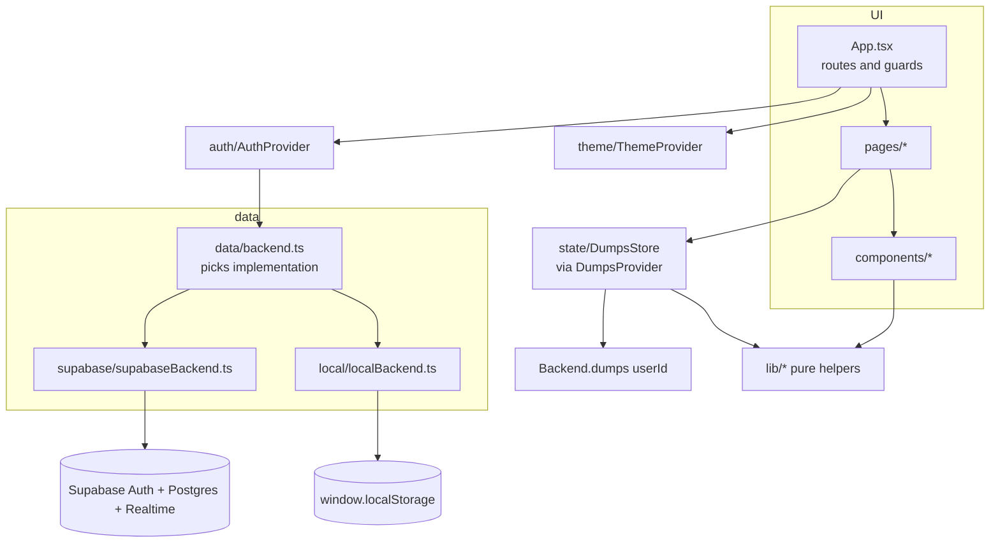

# Mind Dump: Design

> Companion docs: [README.md](README.md) (setup and deploy, user-facing) · [FLOW.md](FLOW.md) (code flow, entry to exit).

## 1. What it is

Mind Dump is a single-page web app for emptying your head and then doing the right things today. Each thought you type becomes a **tile** on a board, and every tile shows how many days it has been waiting. Clicking a tile means "handled": it moves to **History**, where you can restore it or delete it for good. It is built for individuals who want a low-friction, private place to capture loose thoughts and to-dos on phone and desktop.

### Main features

| Feature | Where it lives |
|---|---|
| Add a dump (Enter), or split a pasted list into one tile per line ("Split into N", Ctrl/Cmd+Enter) | [src/components/Composer.tsx](src/components/Composer.tsx), [src/lib/text.ts](src/lib/text.ts) |
| Click a tile to clear it, with an animated exit and an **Undo** toast | [src/pages/BoardPage.tsx](src/pages/BoardPage.tsx) |
| "Days pending" badge whose colour warms with age (fresh, then 3d, 7d, 14d+) | [src/components/DumpCard.tsx](src/components/DumpCard.tsx), [src/lib/days.ts](src/lib/days.ts) |
| Drag and drop reorder (mouse, touch long-press, keyboard via the grip handle) | [src/components/DumpGrid.tsx](src/components/DumpGrid.tsx) |
| Sort modes (My order, Newest, Oldest, A→Z, Z→A, Shortest, Longest) and search | [src/lib/sort.ts](src/lib/sort.ts), [src/pages/BoardPage.tsx](src/pages/BoardPage.tsx) |
| Edit dialog: edit text, delete, Move to top/bottom (a non-drag way to reorder) | [src/components/EditDumpDialog.tsx](src/components/EditDumpDialog.tsx) |
| History grouped by day, with search, restore, delete forever, clear all and "Load more" paging | [src/pages/HistoryPage.tsx](src/pages/HistoryPage.tsx) |
| Email and password accounts: sign up, sign in, forgot/reset password | [src/pages/AuthPages.tsx](src/pages/AuthPages.tsx), [src/auth/AuthProvider.tsx](src/auth/AuthProvider.tsx) |
| Cloud mode (Supabase, with live sync between devices) **or** device-only mode (localStorage) | [src/data/](src/data/) |
| Light, dark and auto themes, with no flash of the wrong theme on load | [index.html](index.html), [src/theme/ThemeProvider.tsx](src/theme/ThemeProvider.tsx) |
| Keyboard shortcuts: `n` or `/` focuses the composer | [src/pages/BoardPage.tsx](src/pages/BoardPage.tsx) |
| Installable web app manifest | [public/manifest.webmanifest](public/manifest.webmanifest) |
| **Planner**: Today queue, "+ Today" on tiles, routines, focus blocks, Skip sheet, Morning Check, Shutdown, hour log, rules (see §8) | [src/pages/TodayPage.tsx](src/pages/TodayPage.tsx), [src/components/today/](src/components/today/), [src/state/planner.ts](src/state/planner.ts) |
| **Priority** (High / Medium / Low) on tiles: a flag chip, a "Priority" sort, shown in Today and the dump picker (see §8.5) | [EditDumpDialog.tsx](src/components/EditDumpDialog.tsx), [PriorityFlag.tsx](src/components/PriorityFlag.tsx), [src/lib/sort.ts](src/lib/sort.ts) |
| **Habit stack**: daily habits with one-tap logging, streaks and consistency, shown on Today and in Shutdown (see §8.5) | [src/pages/HabitsPage.tsx](src/pages/HabitsPage.tsx), [HabitStackCard.tsx](src/components/habits/HabitStackCard.tsx), [src/lib/habits.ts](src/lib/habits.ts) |
| **Hour log Week view** and **named "Other" hours** (see §8.5) | [HourLogStrip.tsx](src/components/today/HourLogStrip.tsx), [HourWeekView.tsx](src/components/today/HourWeekView.tsx), [src/lib/hours.ts](src/lib/hours.ts) |
| **Daily quote** on Today | [src/lib/quotes.ts](src/lib/quotes.ts), [TodayHeader.tsx](src/components/today/TodayHeader.tsx) |
| **Edit a queue item** (name, priority, Block/Task, length, first action, minimum) or **remove it** when it's no longer relevant, optionally clearing its tile | [EditItemDialog.tsx](src/components/today/EditItemDialog.tsx), `Planner.retitle` / `Planner.dismiss` |
| **Sunrise theme** and small rewards: warm colours, a greeting with a kind progress line, and confetti when you finish things | [src/index.css](src/index.css), [celebrate.ts](src/components/celebrate.ts), [lib/greeting.ts](src/lib/greeting.ts) |
| **Download my data**: a JSON backup of everything, from the account menu | [src/data/exportData.ts](src/data/exportData.ts), [AppHeader.tsx](src/components/AppHeader.tsx) |

## 2. Tech stack

| Tech | Used for | Likely reason |
|---|---|---|
| **React 19** + **TypeScript** (strict) | UI | Uses `useSyncExternalStore` for the store. Strict TS (`noUnusedLocals` and similar) catches mistakes at build time. |
| **Vite 8** | Dev server and bundler | Fast HMR. `base` comes from `VITE_BASE`, so one build can target a sub-path host such as GitHub Pages. |
| **Tailwind CSS v4** (`@tailwindcss/vite`) | Styling | Utility classes plus semantic colour tokens (`bg-card`, `text-ink`) defined once in [src/index.css](src/index.css) and switched per theme. |
| **react-router v7** | Routing (`/`, `/today`, `/habits`, `/focus`, `/shutdown`, `/rules`, `/history`, `/login`, `/signup`, `/forgot-password`, `/reset-password`) | Declarative route guards, and `basename` for sub-path deploys. |
| **@dnd-kit** (core, sortable, utilities) | Drag reorder | Accessible: keyboard sensor, screen-reader announcements, touch sensor with long-press. |
| **@supabase/supabase-js** | Auth, Postgres, Realtime | Free hosted backend. Row-level security lets the anon key be public. |
| **sonner** | Toasts (errors, Undo, confirmations) | Toasts with action buttons; theme-aware. |
| **lucide-react** | Icons | |
| **clsx** (re-exported as `cn`) | Conditional class names | [src/lib/cn.ts](src/lib/cn.ts) |
| **Vitest** | Unit tests for pure logic and the store | Shares config with Vite ([vite.config.ts](vite.config.ts)). |
| **Playwright** | End-to-end tests (desktop and mobile projects) | Runs against device-only mode, so no network backend is needed. |

There is no ESLint config or dependency in the repo, although two files contain `eslint-disable` comments.

## 3. Architecture

The code is layered, and dependencies point one way: UI (`App`, `pages/`, `components/`) → `state/`, `auth/`, `theme/`, `hooks/` → `data/` → `lib/` and `domain/`. Nothing in `data/`, `lib/` or `domain/` imports React components (`lib/` and `data/types.ts` do import `domain/` types, and `data/types.ts` imports `PositionUpdate` from `lib/position.ts`).

```
src/
  main.tsx, App.tsx   entry, providers, routes and guards
  pages/              screens: BoardPage, HistoryPage, AuthPages
  components/         presentational and interactive pieces (DumpGrid, DumpCard, Composer, dialogs, ui kit,
                      DayPicker, PriorityFlag); today/ for the planner, habits/ for the habit stack
  state/              DumpsStore (client source of truth) + React binding (DumpsProvider)
  auth/               AuthProvider: current user, ready flag, recovery flag
  theme/              ThemeProvider: light/dark/system preference
  hooks/              useNow (ticking clock), usePersistentState (localStorage-backed state)
  data/               Backend interface + two implementations (supabase/, local/), error mapping
  domain/             plain types: Dump, AppUser, MAX_DUMP_LENGTH, initialsOf
  lib/                pure functions: days, sorting, fractional positions, text, ids
supabase/migrations/  SQL schema, RLS policies, triggers, RPC
e2e/                  Playwright tests (device-only mode)
e2e-cloud/            Playwright smoke test against a real Supabase project (run manually)
```



### Boundaries and responsibilities

- **`data/types.ts` is the contract.** `Backend` exposes `kind`, `auth: AuthApi` and `dumps(userId): DumpsApi`. Nothing above `data/` knows whether Supabase or localStorage is underneath. The only exception is `backendKind`, which the UI uses for banners and labels.
- **`data/backend.ts`** creates the single app-wide backend when the module loads. It uses Supabase if both `VITE_SUPABASE_URL` and `VITE_SUPABASE_ANON_KEY` are set (non-empty after trimming), and otherwise `createLocalBackend(window.localStorage)`.
- **`state/dumpsStore.ts`** is a framework-agnostic class that owns all dump state for one user. It handles optimistic updates, rollback, per-item request ordering, refresh debouncing and history paging. React reads it through `useSyncExternalStore` in [src/state/DumpsProvider.tsx](src/state/DumpsProvider.tsx). Pages call store methods; they never call the backend directly for dumps.
- **`auth/AuthProvider.tsx`** wraps `backend.auth`. Auth pages call `auth.signIn` and similar methods directly. User state changes **only** through the `onChange` listener, never from a method's return value.
- **`lib/`** holds pure functions with no React or I/O. It is unit-tested in [src/lib/lib.test.ts](src/lib/lib.test.ts).
- **`components/ui.tsx`** is the small in-house UI kit: `Button`/`buttonClass`, `TextField`, `PasswordField`, `Modal` (native `<dialog>`), `ConfirmDialog`, `EmptyState`, `Splash`, `Logo`, `LogoMark`, `Kbd` and `focusRing`.

## 4. Data model and storage

### Domain types ([src/domain/](src/domain/))

```ts
type DumpStatus = 'active' | 'done'
interface Dump {
  id: string            // UUID v4, generated on the client (lib/id.ts)
  content: string       // trimmed, max 5000 chars (MAX_DUMP_LENGTH)
  position: number      // fractional ordering key, ascending ("My order")
  status: DumpStatus
  createdAt: string     // ISO; drives "days pending"
  updatedAt: string
  completedAt: string | null
}
interface AppUser { id: string; email: string; displayName: string }
```

### Where data lives

| Data | Cloud mode | Device-only mode |
|---|---|---|
| Accounts / sessions | Supabase Auth (session persisted by supabase-js) | `minddump:local:users` (array with PBKDF2 `salt` + `hash`), `minddump:local:session` (user id) |
| Dumps | `public.dumps` table | `minddump:local:dumps:<userId>` (JSON array) |
| Display name | `auth.users.raw_user_meta_data.display_name` (the app reads it from `user_metadata`). A `public.profiles` row is also kept in sync by a trigger but **the app never reads it**. | stored on the local user record |
| Theme preference | `minddump:theme` in localStorage (both modes) | same |
| Sort mode | `minddump:sort:<userId>` in localStorage (per device, per user) | same |
| Local-mode banner dismissed | n/a | `minddump:local-banner-dismissed` |
| Hour log open, its Day/Week tab, "Start a habit" card hidden | `minddump:hourlog-open`, `minddump:hourlog-view`, `minddump:habit-intro-hidden` (per device) | same |

### Database ([supabase/migrations/20261017000000_init.sql](supabase/migrations/20261017000000_init.sql))

The migration is idempotent; run it once in the Supabase SQL editor.

- **`public.dumps`**: `id uuid pk`, `user_id uuid default auth.uid()`, `content text`, `position double precision`, `status text check in ('active','done')`, `completed_at`, `created_at`, `updated_at`.
  - Check constraint: `char_length(content) <= 5000` and at least 1 non-blank char.
  - Partial indexes: `(user_id, position) where status='active'` for the board, and `(user_id, completed_at desc) where status='done'` for history.
- **`public.profiles`**: `id` (FK to auth.users), `display_name` (≤100), `created_at`, `updated_at`. Filled by `sync_profile_from_auth()` on auth user insert and on metadata update.
- **Triggers**
  - `dumps_set_timestamps` (before insert/update): the server owns timestamps. `id`, `user_id` and `created_at` cannot change on update, so "days pending" cannot be rewritten through the API. `completed_at` is set or cleared only when `status` changes, and the client's value is ignored.
  - `dumps_enforce_quota` (before insert): at most 20,000 dumps per user. Above that it raises `'Dump limit reached (20000)...'`.
- **RPC `set_dump_positions(p_ids uuid[], p_positions float8[])`**: batch reorder in one round trip. It is `security invoker` and also filters `user_id = auth.uid()`. Only `authenticated` may execute it.
- **Realtime**: `public.dumps` is added to the `supabase_realtime` publication.

### Security

- **RLS** on both tables, for the `authenticated` role only. `dumps` has select, insert, update and delete policies where `auth.uid() = user_id`. `profiles` has only select and update policies where `auth.uid() = id` (rows are created by the `security definer` trigger, and no client delete is allowed). Because of this the anon/publishable key is safe to ship to browsers, as noted in [.env](.env) and the README.
- The client also adds `.eq('user_id', userId)` to queries, as defence in depth and to use the indexes.
- **Device-only mode is not a security boundary.** Passwords are hashed with PBKDF2-SHA-256 (120,000 iterations, 16-byte salt; [src/data/local/password.ts](src/data/local/password.ts)), but anyone with the browser profile can read the dumps. It needs `crypto.subtle` (https or localhost) and throws a friendly `AppError` without it.
- **Validation** happens in layers: the auth forms check email format, a non-empty name and a password of 8+ chars on sign-up. Composer and edit textareas set `maxLength=5000`. The store trims and slices to 5000. The DB check constraint is the last line.
- Environment variable names: `VITE_SUPABASE_URL`, `VITE_SUPABASE_ANON_KEY`, `VITE_BASE`. A `.env` with public Supabase values is present in the repo and is **not** gitignored (only `.env.local` and `.env.*.local` are).

## 5. Key design decisions and trade-offs

1. **Pluggable backend with a device-only fallback.** The app works with zero configuration, and E2E tests run without a network. The cost is two implementations of `DumpsApi`/`AuthApi` that must behave the same; `listDone` paging and ordering are written twice.
2. **Optimistic UI with rollback** ([src/state/dumpsStore.ts](src/state/dumpsStore.ts) `mutate()`). Every change applies to local state at once, then runs against the backend. On failure it rolls back, shows a toast and queues a full refresh "so the server has the last word".
3. **Per-dump request chains.** `chains: Map<id, Promise>` serialises requests that touch the same dump. For example, an Undo pressed while `complete` is still in flight reaches the server after it. `clearDone` waits on **all** outstanding chains.
4. **Stale-read protection.** A `version` counter is bumped when a mutation starts and when it settles. Any `loadActive`/`loadDone` whose version changed (or that overlapped an in-flight write) is discarded and re-scheduled through `scheduleRefresh()`, which is debounced by 300 ms.
5. **Fractional positions** ([src/lib/position.ts](src/lib/position.ts)). A drag normally rewrites **one** row (`positionBetween` bisects the neighbours). `planMove` falls back to `rebalance` (even 1024 steps) when the gap drops below `1e-6` or ties exist. New dumps go above the minimum (`topPosition`). Positions can be negative.
6. **The order shown wins.** `moveTo(movedId, orderedIds)` takes the order the user saw after the drop instead of recomputing indexes. Dragging in a non-custom sort calls `setOrder` to adopt that order as "My order" and switches the sort.
7. **One comparator.** `byPosition` (position, then createdAt, then id) is shared by the store, the board and the drag logic so tie-breaks always agree.
8. **Implicit auth flow** (not PKCE) in supabase-js. Confirmation and reset links work even when opened in a different browser, such as a mail app's in-app browser. Sign-out is `scope: 'local'` (this device only).
9. **Live sync = Realtime INSERT/UPDATE plus refetch on focus or visibility change.** Realtime DELETE events cannot be filtered by column, so remote deletes only appear on the next focus or refresh. Each event triggers a debounced **full refetch** rather than patching from the payload, which is simpler and always consistent.
10. **`DumpsProvider` is keyed by user id** ([src/App.tsx](src/App.tsx) `AppLayout`), so no state survives an account switch.
11. **History loads lazily.** It only loads (and only refreshes) while the History page is mounted (`setHistoryOpen`), 50 per page. The supabase backend fetches `limit + 1` rows to learn `hasMore`.

### Known limitations

- History search only filters **loaded** pages (the empty-state text says "Nothing in loaded history matches").
- Deleting a tile from the board has no Undo; it uses a confirm step in the edit dialog. Deletes in History use a `ConfirmDialog`.
- Remote deletes are not live (see decision 9).
- The 20,000-dump quota counts done dumps too.
- `public.profiles` is created but unused by the client.
- CI ([.github/workflows/deploy-pages.yml](.github/workflows/deploy-pages.yml)) runs unit tests and `npm run build` (which includes `tsc -b`), but **not** the Playwright E2E suite.
- Free Supabase projects pause after inactivity (README).

### Notable UX/UI patterns

- **Sunrise palette** ([src/index.css](src/index.css)): a pending list drains energy, so the surfaces are meant to feel warm and light rather than clinical.
  - Light mode: a cream canvas (`#fdf8f3`), warm lines, plum-tinted ink, and a fixed, decorative `body::before` glow in peach, lavender and mint.
  - Dark mode: a deep plum night with a faint violet, rose and teal glow.
  - Primary buttons use a violet → rose gradient (`--accent-from` → `--accent-to`).
  - Every text token was checked at ≥ 4.5:1 against canvas, card and sunken surfaces (the lowest is 4.99:1), and white text on both gradient ends is ≥ 5.6:1.
- **Rewards, not guilt**:
  - [celebrate.ts](src/components/celebrate.ts) fires a small confetti burst when a tile is cleared, a Today item is done or a habit is ticked. It fires a big one when the queue empties, every due habit is done, or a block ends with its minimum met.
  - It uses only the Web Animations API and is skipped under `prefers-reduced-motion`.
  - Today greets you by first name, and `momentumLine` ([lib/greeting.ts](src/lib/greeting.ts)) gives a kind, specific progress line ("3 done today. Keep the streak rolling.") instead of a count of what's left.

- **No theme flash**: an inline script in [index.html](index.html) reads `minddump:theme` and sets the `.dark` class and `theme-color` metas before React loads. `ThemeProvider` then keeps them in sync with `useLayoutEffect`.
- **Semantic colour tokens** (`--canvas`, `--card`, `--ink`, `--accent`, ...) in [src/index.css](src/index.css) are redefined under `.dark` and exposed to Tailwind with `@theme inline`. Dark mode uses `@custom-variant dark (&:where(.dark, .dark *))`.
- **Animated clear**: the tile gets `animate-tile-out` for 220 ms (`EXIT_MS`; 0 with `prefers-reduced-motion`) before the store mutation. A global reduced-motion rule shortens all animations.
- **Focus management**: after a tile is cleared or deleted, focus moves to the neighbour's "Mark done" button or back to the composer (`focusAfterRemoval`).
- **Accessibility**: the whole tile is a `button` ("Mark done: …"). A separate grip `button` is the keyboard drag handle, and dnd-kit announcements are worded for dumps. The modal is a native `<dialog>`, so focus trapping and Escape come with it; it closes on the backdrop only when the press **started** there.
- **Touch**: drag needs a 220 ms long-press so swipes still scroll. On coarse pointers Enter inserts a newline (the Dump button submits), the grip ignores pointer events, and the edit button is always partly visible. `.tile-touch` turns off the iOS callout and text selection.
- A click that fires within 250 ms of a drop is ignored (`CLICK_AFTER_DRAG_MS`), so a drop does not clear the tile.
- Responsive auto-fill grid (`minmax(9.5rem,1fr)`, or `13rem` from `sm` up) with safe-area insets; tested for no horizontal overflow on desktop and Pixel 7.

## 6. How to extend

| You want to... | Do this |
|---|---|
| Add a field to dumps (e.g. a colour or a pin) | Add a column in a **new** file in `supabase/migrations/`. Update `Dump` in [src/domain/dump.ts](src/domain/dump.ts), `DumpRow`/`COLUMNS`/`toDump` in [src/data/supabase/supabaseBackend.ts](src/data/supabase/supabaseBackend.ts), and the local backend's `create`. Add a `DumpsApi` method in [src/data/types.ts](src/data/types.ts) and implement it in **both** backends. |
| Add a new mutation | Add a method on `DumpsStore` that calls `this.mutate({ keys, apply, rollback, run, error })`. Keep `apply` and `rollback` as pure `setState` calls and pass every affected dump id in `keys`. Add a test to [src/state/dumpsStore.test.ts](src/state/dumpsStore.test.ts) using `createLocalBackend(memoryStore(), ...)`. |
| Add a sort mode | Extend `SortMode`, `SORT_OPTIONS` and `comparators` in [src/lib/sort.ts](src/lib/sort.ts). End with `|| byPosition(a, b)` for stable ties. |
| Add a page | Create it in `src/pages/` and add a `<Route>` in [src/App.tsx](src/App.tsx). Put it inside the `RequireAuth`/`AppLayout` route if it needs the user or the dumps store, or wrap it in `PublicOnly` for signed-out-only screens. |
| Add a new backend | Implement `Backend` from [src/data/types.ts](src/data/types.ts) and choose it in [src/data/backend.ts](src/data/backend.ts). |
| Add a user preference | Use `usePersistentState(key, fallback, validate)` with a `minddump:` key prefix, and include the user id if it is per user. |

**Conventions**

- Import with the `@/` alias (maps to `src/`).
- Throw `AppError` for messages that are safe to show the user, and render errors with `errorMessage()` ([src/data/errors.ts](src/data/errors.ts)).
- Store errors go to the `reportError` callback (sonner `toast.error`). Pages show success toasts.
- Use the `ui.tsx` primitives and the semantic colour utilities (`bg-card`, `text-ink-muted`, `border-line`), not raw hex colours.
- Wrap every `localStorage` access in `try/catch`; storage can be unavailable.
- Pure logic goes in `lib/` with unit tests. Keep the components presentational where you can.
- Schema changes must stay idempotent (`if not exists`, `drop ... if exists`) and keep RLS enabled.

## 7. Commands

Scripts from [package.json](package.json):

| Command | What it does |
|---|---|
| `npm install` | Install dependencies |
| `npm run dev` | Vite dev server on http://localhost:5173. Because the committed `.env` sets the Supabase variables, this runs in **cloud mode** against the real project; set them to empty values in `.env.local` to get device-only mode. |
| `npm run build` | `tsc -b && vite build` → `dist/` |
| `npm run preview` | Serve the built `dist/` |
| `npm run typecheck` | `tsc -b` only |
| `npm test` | Vitest unit tests (`src/**/*.test.ts`) |
| `npm run test:e2e` | Playwright ([playwright.config.ts](playwright.config.ts)): starts Vite on port 5180 with the Supabase vars blanked (device-only), runs `desktop` and `mobile` projects. Needs `npx playwright install chromium` first. |
| `npx playwright test -c playwright.cloud.config.ts` | Manual smoke test: builds with `VITE_BASE=/mind-dump/`, previews on port 5190 and runs [e2e-cloud/smoke.spec.ts](e2e-cloud/smoke.spec.ts) against the **real** Supabase project in `.env`. It creates real test accounts. |
| `npx playwright test -c playwright.live.config.ts` | The same smoke test against the **deployed** site (https://gamernishant.github.io/mind-dump/) on desktop and mobile. Run it after a deploy. It also creates real test accounts. |

**Deploy**

- **GitHub Pages**: [.github/workflows/deploy-pages.yml](.github/workflows/deploy-pages.yml) runs on push to `main` or by manual dispatch. Steps: `npm ci` → `npm test` → `npm run build` with `VITE_BASE=/<repo>/` (or `/` for a `*.github.io` repo) → `cp dist/index.html dist/404.html` (so deep links work, since Pages has no SPA rewrites) → upload and deploy.
- **Vercel / Netlify / Cloudflare Pages**: build `npm run build`, output `dist`. SPA rewrites come from [vercel.json](vercel.json) and [public/_redirects](public/_redirects).
- **Supabase setup** (one time): run the migration SQL, then set Site URL and Redirect URLs. The README covers email confirmation and SMTP.

## 8. Planner (Today, focus, shutdown)

### 8.1 What it is for

The planner implements a daily execution system written for the owner, an early riser preparing for an exam. Its four rules:

- **Sequence, not clock.** Today is an ordered queue, never a timetable.
- **Nothing leaves Today silently.** Every item ends Done, or Skipped with a reason.
- **The dump stays the source.** Today items point at tiles, and tiles stay on the board.
- **The Floor.** A minimum day is one block's minimum plus shutdown, and you never miss twice.

The app is meant to take under 2 minutes in the morning and under 10 at night.

| Screen / piece | What it does | Code |
|---|---|---|
| **+ Today** on each tile | Adds the tile to today's queue. The tile stays and gets an "In Today" chip. The caps apply. | [DumpCard.tsx](src/components/DumpCard.tsx), [BoardPage.tsx](src/pages/BoardPage.tsx) |
| **Today** (`/today`) | The day's screen. Top: header (blocks done / cap, 7 Floor dots, "never miss twice"), Restart card, Morning Check card, **Next** card. Middle: the draggable **Queue**. Each item shows Block/Task, minutes, first action, minimum and carried ×N, with Done, Start and Skip. Bottom: add form (adding also creates a tile), "Pick from dump", hour log strip. | [TodayPage.tsx](src/pages/TodayPage.tsx), [components/today/](src/components/today/) |
| **Skip sheet** | Start, Shrink, Say: "Do just 2 minutes", "Shrink to 10 min", or skip with a reason and a destination (later today / tomorrow / back to dump). Shows the matching if-then rules. | [SkipSheet.tsx](src/components/today/SkipSheet.tsx) |
| **Focus** (`/focus`) | Countdown for the running block. It is wall-clock based, survives reloads and syncs across devices. Controls: pause, +10, end, and "Park a thought" (creates a tile). The end dialog asks "minimum met?" and "where did you stop?". That answer is saved as the tile's **Bookmark** and becomes the next first action. Study hours fill in automatically. | [FocusPage.tsx](src/pages/FocusPage.tsx) |
| **Shutdown** (`/shutdown`) | A 10-minute screen. Resolve every open item, build tomorrow's queue, set Block 1's first action and minimum, tick the food check, then press "Shutdown complete". This records blocks done and the Floor. | [ShutdownPage.tsx](src/pages/ShutdownPage.tsx) |
| **Repeat** in the edit dialog | Priority, then Off / Daily / Weekdays / chosen days, plus type, minutes, Light routine (doesn't count toward caps), minimum and Bookmark. Also "Split into lines" and "Make it a habit". | [EditDumpDialog.tsx](src/components/EditDumpDialog.tsx) |
| **Rules** (`/rules`) | If-then plans, seeded with 15 starters and editable. Plan settings: block cap (the Ramp, 1–4), task cap, day start hour. | [RulesPage.tsx](src/pages/RulesPage.tsx) |
| **Hour log** | "Where did the time go?": tap hours and mark a category (Study, Phone, Sleep, Food, Build, Chores, Leisure), or **Other…**, which asks what it was ("Gym") and keeps the name as a quick pick. A **Week** tab shows where the hours went, Monday to Sunday. | [HourLogStrip.tsx](src/components/today/HourLogStrip.tsx), [HourWeekView.tsx](src/components/today/HourWeekView.tsx) |
| **Habits** (`/habits`, plus a card on Today) | The habit stack: small daily things that aren't tasks. One tap logs today. Shows the streak, the best streak and a 30-day consistency rate. Tap any of the last 7 days to fix it; a 12-week history grid. Due habits show highlighted near the top of Today and in Shutdown's checks. | [HabitsPage.tsx](src/pages/HabitsPage.tsx), [HabitStackCard.tsx](src/components/habits/HabitStackCard.tsx) |
| **Daily quote** | A short quote at the top of Today, one per planner day. | [TodayHeader.tsx](src/components/today/TodayHeader.tsx), [lib/quotes.ts](src/lib/quotes.ts) |
| Morning landing | Before noon, the first visit to `/` in a browser session opens `/today`. | `MorningLanding` in [App.tsx](src/App.tsx) |

### 8.2 Data model: one generic document table

All planner data lives in **`public.planner_docs`** ([migration](supabase/migrations/20261018000000_planner.sql)):

- **Columns:** `id uuid`, `user_id`, `kind text`, `day text (YYYY-MM-DD) | null`, `data jsonb`, and timestamps.
- **Rules on the table:**
  - RLS: users can only reach their own rows.
  - Timestamps are set by the server, and `kind` can't change after insert.
  - Each document is capped at 32 KB, with a quota of 50,000 rows per user.
  - Realtime is enabled.
- **Device-only mode** stores the same documents in `minddump:local:planner:<userId>`.

Why one table: the owner can't easily run a migration every time a feature changes, so new planner features ship as new `kind`s without SQL. The trade-off is weaker typing in the database. The client types in [src/domain/plan.ts](src/domain/plan.ts) do the validation instead.

| `kind` | `day` | id | `data` ([src/domain/plan.ts](src/domain/plan.ts)) |
|---|---|---|---|
| `today_item` | planned day | random; routine instances use `stableId('today_item','routine',dumpId,day)` (dump ids are unique per user) | `TodayItem`: dumpId, title, type block/task, minutes, firstAction, minimum, order, status open/done/skipped, minMet, skips[], carriedFrom, carryCount, routine, habit, doneAt |
| `tile_meta` | null | **= the dump's id** | `TileMeta`: repeat weekdays, defaultType/Minutes/Minimum, habit (labelled "Light routine": doesn't count toward the cap), resumeNote (Bookmark), skipCount, carryCount, **priority** (`high`/`medium`/`low`/null) |
| `focus_session` | day | random | `FocusSession`: itemId, plannedMin, startedAt, pausedAt/pausedMs, endedAt, minMet, stoppedAt, starter |
| `hour_log` | day | `stableId('hour_log',userId,day)` | `{ hours: { "4": "study", "18": "other:Gym", ... } }`: a category, or `other:<name>` |
| `day_plan` | day | `stableId('day_plan',userId,day)` | `DayPlan`: morningCheckAt, block1, shutdownAt, blocksDone, floorMet, foodSorted, tomorrowFirst, restartAt |
| `rule` | null | random; the 15 starter rules use `stableId('rule','seed',userId,i)` | `Rule`: ifText, thenText, reason, active, order |
| `settings` | null | `stableId('settings',userId)` | `PlanSettings`: blockCap (2), taskCap (5), dayStartHour (3), rulesSeeded, otherTags (saved names for Other hours) |
| `habit` | null | random | `Habit`: name, days (weekdays it's due), done (planner days it was logged, sorted), order, startDay |

### 8.3 Architecture

- **`PlannerApi`** ([types.ts](src/data/types.ts)) has `list({kinds, sinceDay})`, `upsert`, `insertMissing` (inserts only new ids: `on conflict do nothing`), `remove` and `watch`.
  - The Supabase `list` pages through results 1000 rows at a time, because PostgREST caps each response at the project's "Max rows".
  - The Supabase `watch` adds a refetch every 60 s while the page is visible. Realtime DELETE events can't be filtered by user, so they aren't subscribed to, and this refetch is how a delete made on another device shows up.
  - Both backends implement it.
  - A missing table (PostgREST `PGRST205` / `42P01`) becomes a `SetupRequiredError`.
- **`PlannerStore`** ([plannerStore.ts](src/state/plannerStore.ts)) works the same way as `DumpsStore`:
  - Changes apply optimistically, go to the backend, and roll back with a toast if the backend fails.
  - Requests are chained per document, stale reads are discarded, and watch events trigger a debounced refresh.
  - It holds `docs: Map<id, PlannerDoc>` and `status`, which is `setup` when the table is missing.
  - It also holds `loadSeq`, which goes up by one with every successful load, and `refreshing`, which is true while a refetch is pending. The rollover uses both to make sure it only acts on fresh data.
  - It loads every kind, but only dated documents from the last 45 days.
- **`Planner`** ([planner.ts](src/state/planner.ts)) holds the use-cases: add from dump, add text, reorder, complete, skip, focus start/pause/end, hour log, morning check, shutdown, restart, tile meta, rules and settings. The UI calls only these.
- **Pure logic** ([lib/plan.ts](src/lib/plan.ts), unit-tested): planner days, `stableId`, caps, the Floor and its dots, `planRollover`, hour-log helpers, focus timing.
- **`PlannerProvider`** ([PlannerProvider.tsx](src/state/PlannerProvider.tsx)) sits inside `DumpsProvider`.
  - It creates the store and the `Planner`, and runs the **RolloverRunner**.
  - It exposes `usePlanner()`, `usePlannerState()` and `useToday()` (the derived view of the current day).

### 8.4 Key decisions

1. **The planner day starts at 3 AM** (`dayStartHour`), so late nights belong to the previous day and a 4 AM start counts as "today".
2. **Rollover is pure and idempotent** (`planRollover`). It handles four cases:
   - **Yesterday's open, non-routine items** move to the end of today with `carryCount+1`. At a count of 3 the UI suggests splitting the item.
   - **Routines left open** close as skipped "Not resolved". They never carry over.
   - **Recurring tiles due today** each get a routine item. The id is deterministic and the write uses `insertMissing`, so two devices rolling over at 3 AM can't duplicate an item or overwrite progress.
   - **Items older than yesterday** are **stale**. They wait until the user picks Restart or Bring back.

   The runner attempts each write once per session, so a failing write can't loop.
3. **Caps** default to 2 blocks (maximum 4) and 5 tasks. Open and done items count toward a cap. Skipped items and habits don't.
4. **Focus sessions are planner documents.** A block started on the laptop shows on the phone. Elapsed time is computed from timestamps minus pauses.
5. **The Bookmark** (`tile_meta.resumeNote`) is written at the end of a block or during the morning check. It becomes the next first action whenever the tile is queued.
6. **Typing an item in Today creates a dump tile too**, so the dump stays the single source.
7. **Per-user ids for singletons.** `planner_docs.id` is a primary key across the whole table, so the deterministic ids for each user's settings, day plans and hour logs include the user id. They are read back by kind and day, not by id, so documents written under an older id scheme still load (the most recently updated one wins).
8. **No duplicates.** A tile has at most one live item per day:
   - Rollover and routine creation skip any tile that already has a live item that day.
   - Skipping an item to tomorrow, when the tile is already planned for tomorrow, closes this copy instead of moving it.
   - Bring back closes duplicates and respects the caps. Items that don't fit stay stale.
9. **Focus stays honest.**
   - Done or Skip on an item ends its running block.
   - A block's end time is capped at its planned end, so a dialog left unanswered doesn't log extra hours.
   - A watcher that is always mounted (`FocusAlarm`) plays the time-up chime and shows a toast even when you're not on `/focus`.
10. **Tiles that disappear.** Deleting a tile, or splitting it into lines, calls `planner.retireDump`. Its open items then close with the reason "Tile removed".
11. **Cloud mode needs a one-time setup.** If the table is missing, Today shows a **SetupCard** with the SQL, a copy button and a link to the project's SQL editor.

### 8.5 Habits, priority, named Other hours, quote, backup

All of these were added without any SQL: they are a new `kind` (`habit`) and new fields on existing documents in `planner_docs`.

- **Habits are not Today items.** A Today item ends Done or Skipped; a habit is just yes or no per day. So habits skip the queue, the caps and the rollover. Each habit is **one undated document** whose `done` array lists the days it was logged. This has three benefits:
  - streaks work over any span, even though dated documents only load for 45 days;
  - each tap is one write;
  - there is nothing to roll over at 3 AM.

  A habit document stays far under the 32 KB cap, which allows about 2,400 logged days.
- **Streak rules** ([lib/habits.ts](src/lib/habits.ts), unit-tested):
  - A streak counts done days going back from today. Days the habit isn't due are skipped over.
  - **Today not being done yet never breaks a streak.**
  - Consistency is done ÷ due over the last 30 days, counted from the day the habit was added. Logging a day before that moves the start back.
  - If the last due day was missed, the habit shows "Never miss twice" (the same rule as the Floor).

  These follow common habit-app practice: a one-tap check-in, a visible row of days, a forgiving streak, and backfill limited to the last 7 days.
- **"Make it a habit"** in a tile's edit dialog creates a habit from the tile's first line and clears the tile. The toast's Undo reverses both.
- **The older `habit` flag on tiles** (meals and snacks that don't count toward the cap) is now labelled **Light routine**, so it isn't confused with the habit stack. The stored field name is unchanged.
- **Priority lives in `tile_meta`**, not in `public.dumps`, so it needed no migration. The trade-off: priority isn't available until the planner has loaded, and sorting by it happens on the client (`sortDumps(dumps, 'priority', priorityOf)`).
- **Named Other hours** are stored as `other:<name>` and **roll up under Other** in every summary, with the names listed as a breakdown. A name that matches a built-in category (for example "sleep") becomes that category. This keeps the chart at 8 colours however many names are added; a 9th colour would have to be generated, and couldn't be checked for colour-blind safety.
- **Category colours** were changed so they pass the dataviz palette validator's normal-vision check: Food is now yellow-700, Build purple-700 and Leisure orange-700. The closest pair for colour-blind readers (Study and Phone) is in the ΔE 6–8 band. That is allowed because every cell, chip and bar also shows the category's initial or name.
- **Week view** ([HourWeekView.tsx](src/components/today/HourWeekView.tsx)):
  - one stacked bar per day, on a fixed 24-hour scale so days compare honestly;
  - 2px gaps between segments, and a native tooltip on each one;
  - a real `<table>` of totals, shares and the change from the week before.

  You can step back about 6 weeks, which is the planner's 45-day load window.
- **Quotes** are a fixed offline list ([lib/quotes.ts](src/lib/quotes.ts)), and `quoteOfDay(day)` picks one per planner day, so nothing is fetched. Uncertain attributions are marked "(attributed)" or "Unknown".
- **Editing and removing queue items** ([EditItemDialog.tsx](src/components/today/EditItemDialog.tsx)):
  - Every queue row and the Next card has a pencil, and tapping a row's title opens it too.
  - **Rename** (`Planner.retitle`) also rewrites the first line of the tile, so the dump stays the single source.
  - **Priority** writes the tile's `tile_meta`.
  - **Remove** (`Planner.dismiss`) closes the item as skipped with the reason `not_relevant`, so "nothing leaves Today silently" still holds. You can optionally clear its tile to History as well, and Undo reopens the item and restores the tile.
  - "No longer relevant" is also one of the reasons in the Skip sheet and in Shutdown.
- **The backup** ([data/exportData.ts](src/data/exportData.ts)) reads straight from the backend rather than the stores. It therefore includes all history and every planner document, with no date cut-off.

### 8.6 How to extend the planner

1. Add a new `kind` to `KIND`, and its data type, in [domain/plan.ts](src/domain/plan.ts).
2. Add pure helpers to [lib/plan.ts](src/lib/plan.ts), with tests.
3. Add use-case methods to `Planner`.
4. Read the data through `useToday()` or `usePlannerState()`.

No migration is needed unless you want server-side constraints or queries on `data`.
