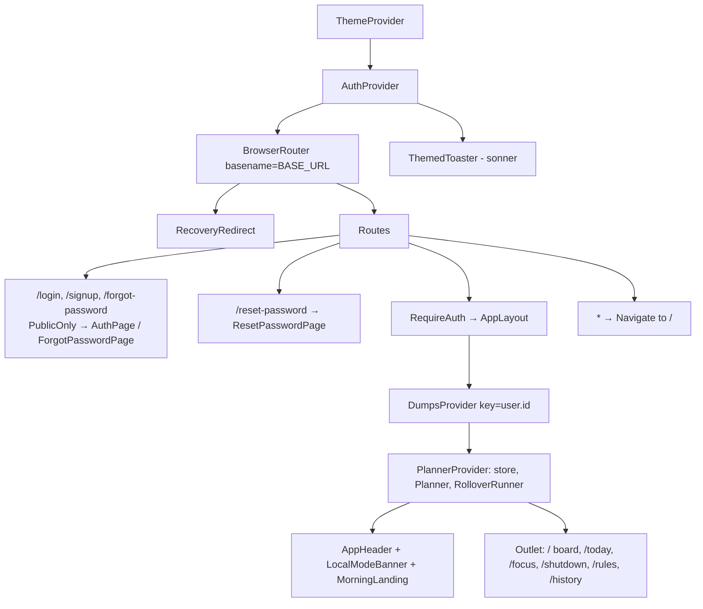
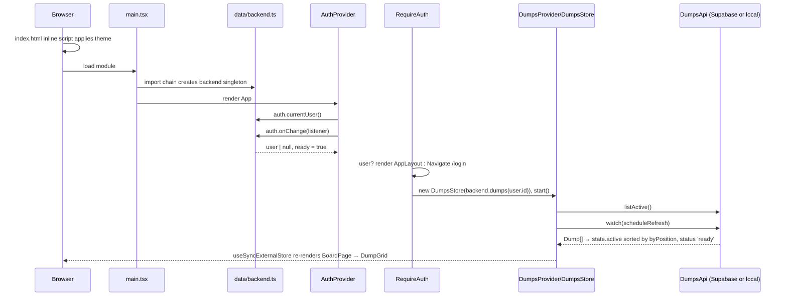
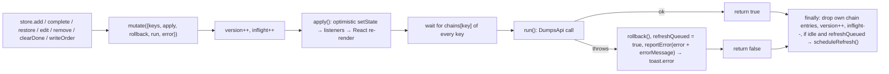
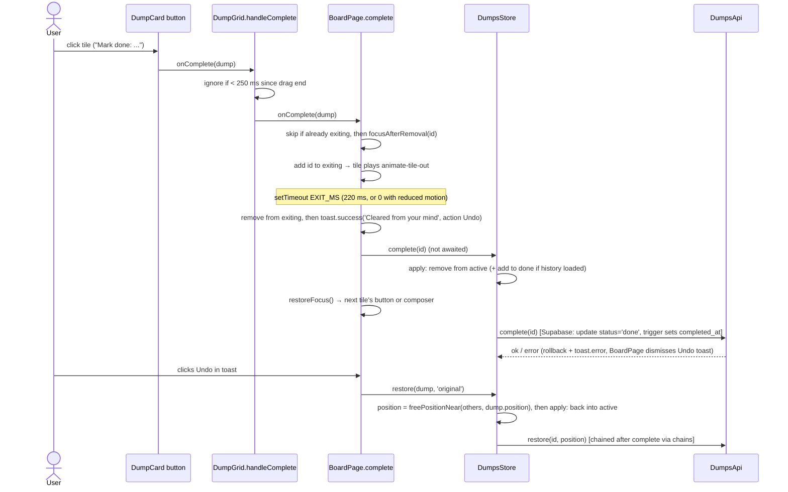
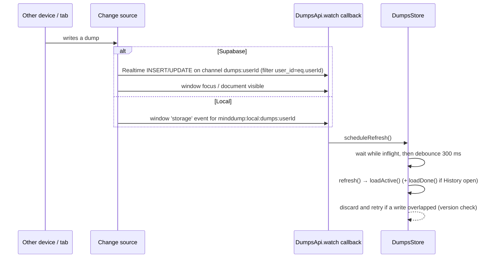

# Mind Dump: Code Flow

> Companion docs: [DESIGN.md](DESIGN.md) (architecture, data model, decisions) · [README.md](README.md) (setup).

This file traces the code from the first byte the browser loads to sign-out and teardown. File links are relative to the repo root.

---

## 1. Entry points and initialisation

### 1.1 Load order

```
index.html → (inline theme script) → /src/main.tsx → src/App.tsx → providers → routes → page
```

1. **[index.html](index.html)**
   - Sets the viewport (with `viewport-fit=cover`), the `theme-color` metas, the favicon, the manifest and the Inter font from Google Fonts. `%BASE_URL%` is replaced by Vite with the deploy base.
   - **Inline script, run before first paint**: reads `localStorage['minddump:theme']` (default `'system'`), toggles the `dark` class on `<html>` and rewrites the `theme-color` metas. This avoids a light/dark flash. Errors are swallowed.
   - Loads `<script type="module" src="/src/main.tsx">`.
2. **[src/main.tsx](src/main.tsx)**: imports `App` and then [src/index.css](src/index.css) (Tailwind, colour tokens, animations), then runs `createRoot(#root).render(<StrictMode><App/></StrictMode>)`.
3. **Module evaluation, before any render.** `App.tsx` imports `AuthProvider`, which imports **[src/data/backend.ts](src/data/backend.ts)**. That module runs once:
   - It reads `import.meta.env.VITE_SUPABASE_URL` and `VITE_SUPABASE_ANON_KEY`, trimmed.
   - If both are set it calls `createSupabaseBackend(url, key)` ([src/data/supabase/supabaseBackend.ts](src/data/supabase/supabaseBackend.ts)). This calls `createClient(...)` with `flowType: 'implicit'`, `persistSession`, `autoRefreshToken` and `detectSessionInUrl`. The Supabase client then restores any saved session and parses `#access_token=...` from the URL (email links).
   - Otherwise it calls `createLocalBackend(window.localStorage)` ([src/data/local/localBackend.ts](src/data/local/localBackend.ts)).
   - The result is exported as the singleton `backend`.
4. **[src/App.tsx](src/App.tsx) `App`** renders this tree (outermost first):



### 1.2 What each provider does on mount, in order

| # | Component | Initialisation |
|---|---|---|
| 1 | `ThemeProvider` ([src/theme/ThemeProvider.tsx](src/theme/ThemeProvider.tsx)) | `readPreference()` from `minddump:theme`. Reads `matchMedia('(prefers-color-scheme: dark)')` and subscribes to its `change` event. A `useLayoutEffect` applies the `.dark` class and the `theme-color` metas for the resolved theme. |
| 2 | `AuthProvider` ([src/auth/AuthProvider.tsx](src/auth/AuthProvider.tsx)) | Starts with `user=null, ready=false`. Its effect calls `backend.auth.currentUser()`, then `update(user)` and `setReady(true)` (a failure counts as signed out). It also subscribes with `backend.auth.onChange(...)`, which updates the user, sets `ready`, sets `recovery=true` on the `'recovery'` event and clears it on `'signed-out'`. `sameUser()` keeps the same object for no-op token refreshes. |
| 3 | `BrowserRouter` | `basename` = `import.meta.env.BASE_URL` without the trailing slash (e.g. `/mind-dump`). |
| 4 | `RecoveryRedirect` | If `recovery` is true and the path is not `/reset-password`, it forces `/reset-password`. |
| 5 | Route guards | `RequireAuth`: shows `<Splash/>` until `ready`, then sends signed-out users to `/login` with `state.from`. `PublicOnly`: sends signed-in users to `state.from` (if it is not `/login` or `/signup`) or to `/`. |
| 6 | `AppLayout` → `DumpsProvider` ([src/state/DumpsProvider.tsx](src/state/DumpsProvider.tsx)) | Keyed by `user.id`. Its `useMemo` creates `new DumpsStore(backend.dumps(userId), msg => toast.error(msg))`. Its effect calls `store.start()`, which runs `loadActive()` and `api.watch(() => scheduleRefresh())`, and calls `store.stop()` on cleanup. |
| 6b | `PlannerProvider` ([src/state/PlannerProvider.tsx](src/state/PlannerProvider.tsx)) | Inside `DumpsProvider`. Creates `new PlannerStore(backend.planner(userId), ALL_KINDS, sinceDay = today − 45 days, toast.error)` and `new Planner(store, dumpsStore)`. Its effect calls `store.start()` (`load()` + `watch`). Renders `RolloverRunner` (see §7.2). `MorningLanding` (App.tsx) sends the first `/` visit of a browser session to `/today` before noon. |
| 7 | `BoardPage` ([src/pages/BoardPage.tsx](src/pages/BoardPage.tsx)) | `useNow()` sets a 60 s interval plus a `visibilitychange` re-tick. `usePersistentState('minddump:sort:<userId>')` loads the sort mode. A window `keydown` listener handles the `n`/`/` shortcut. Shows `SkeletonGrid` while `activeStatus` is `idle` or `loading`. |

In dev, React `StrictMode` mounts effects twice. `DumpsStore.start()` returns early if already watching, and `stop()` resets `unwatch`, so the mount/unmount/mount cycle is safe.



---

## 2. The core engine: `DumpsStore.mutate()`

Every dump write goes through one private method in [src/state/dumpsStore.ts](src/state/dumpsStore.ts). It helps to understand it before the feature traces.



- **`chains`** (`Map<dumpId, Promise>`) makes requests for the same dump reach the server in order.
- **`version` / `inflight`**: `loadActive()` and `loadDone()` remember the `version` they started with. If it changed, or a write is in flight, they drop the result and call `scheduleRefresh()`.
- **`scheduleRefresh()`**: while writes are in flight it only sets `refreshQueued`. Otherwise it sets a 300 ms debounced timer that calls `refresh()`, which runs `loadActive()` and also `loadDone()` if History is open.
- `setState()` merges the patch and notifies subscribers. `DumpsProvider`'s `useDumpsState()` reads it with `useSyncExternalStore`.

---

## 3. User actions, step by step

### 3.1 Sign up

1. The user fills in Name, Email and Password on `/signup`. [src/pages/AuthPages.tsx](src/pages/AuthPages.tsx) renders `AuthPage mode="signup"` inside `PublicOnly`.
2. `onSubmit` → `validate()`: name is required, email must match `EMAIL_RE`, password needs at least 8 characters. Invalid fields get `aria-invalid` and the first one is focused.
3. `auth.signUp({ email, password, displayName })`:
   - **Supabase**: `sb.auth.signUp` with `options.data.display_name` and `emailRedirectTo: appUrl('/')`. If the result has a user with an empty `identities` array, it throws `AppError('An account with this email already exists...')`. It returns `'signed-in'` if a session came back, otherwise `'confirm-email'`. In the database, the trigger `on_auth_user_created` → `sync_profile_from_auth()` inserts a `public.profiles` row.
   - **Local**: `assertCrypto()`, lowercase the email, reject duplicates, `newSalt()` + `hashPassword()` (PBKDF2), append to `minddump:local:users`, set `minddump:local:session`, `emit('signed-in')`.
4. On `'confirm-email'` the page shows "Check your inbox" (`confirmSentTo`).
5. On `'signed-in'` the auth listener fires. Supabase: `onAuthStateChange` → `setTimeout(0)` → `listener(user, 'signed-in')`. AuthProvider then sets `user`, and `PublicOnly` redirects to `/`. The page itself never navigates.

### 3.2 Sign in

1. `/login` → `AuthPage mode="login"`. `validate()` checks email format and a non-empty password.
2. `auth.signIn(email, password)`:
   - **Supabase**: `signInWithPassword`. Errors go through `authError()`, which maps them to friendly `AppError`s: wrong credentials, unconfirmed email, rate limit (429), and so on.
   - **Local**: find the user by lowercased email, re-hash and compare, set the session key, `emit('signed-in')`. Failure throws "Wrong email or password."
3. The auth listener sets the user → `PublicOnly` redirects to `state.from` or `/` → `AppLayout` mounts `DumpsProvider` (§1.2 step 6).

### 3.3 Email confirmation link (Supabase only)

1. The link opens the app root (`emailRedirectTo: appUrl('/')`) with `#access_token=...` in the hash.
2. The Supabase client (`detectSessionInUrl`) parses the hash and fires `SIGNED_IN` → listener → user set → normal board load.

### 3.4 Forgot and reset password

1. `/forgot-password` → `ForgotPasswordPage`. If `auth.supportsPasswordReset` is false (local backend) it shows an explanatory screen only.
2. Submit → email regex check → `auth.requestPasswordReset(email)` → `sb.auth.resetPasswordForEmail(email, { redirectTo: appUrl('/reset-password') })` → "Check your inbox". `appUrl()` respects the deploy base.
3. The email link opens `/reset-password#access_token=...&type=recovery`. On GitHub Pages this deep path is served by `404.html`, a copy of `index.html`, so the SPA still boots. The Supabase client fires `PASSWORD_RECOVERY` → listener `'recovery'` → `AuthProvider.recovery = true` → `RecoveryRedirect` pins the user to `/reset-password`, even though they are now signed in.
4. `ResetPasswordPage`:
   - It shows `<Splash/>` while `!ready` or while the hash has `access_token` but no user yet.
   - If there is still no user, it shows "Link expired" with `error_description` from the hash or query string.
   - On submit it checks the password is 8+ characters and matches the confirmation, then calls `auth.updatePassword` (`sb.auth.updateUser`). Then `clearRecovery()`, `toast.success('Password updated')` and `navigate('/')`.

### 3.5 Add a dump (or a split list)

1. The user types in the composer ([src/components/Composer.tsx](src/components/Composer.tsx)). The textarea grows up to 240 px (`useLayoutEffect`), and `splitLines(value)` ([src/lib/text.ts](src/lib/text.ts)) counts non-empty lines after stripping list markers.
2. The trigger `handleKeyDown` / `handleSubmit` calls `submit(split)`:
   - **Enter** (fine pointer, no Shift) → `submit(false)`. On touch devices Enter inserts a newline.
   - **Ctrl/Cmd+Enter** → `submit(lines.length > 1)`.
   - The **"Split into N"** button → `submit(true)`. The **Dump** button → form submit → `submit(false)`.
3. `submit` clears the textarea right away, keeps focus, and calls `onSubmit(split ? splitLines(text) : [text])`, which is `store.add(items)` from `BoardPage`.
4. `DumpsStore.add(contents)`:
   1. Trim each entry, slice to `MAX_DUMP_LENGTH` (5000) and drop blanks. If nothing is left, return `false`.
   2. `ensureActiveLoaded()`. The top position is `topPosition(active)` = min − 1024. If the board could not load, it uses `-Date.now()`.
   3. Build drafts with `newId()` ([src/lib/id.ts](src/lib/id.ts)) and positions stepping by `POSITION_STEP`, so the first line ends up on top.
   4. `mutate`: **apply** prepends the drafts (sorted by `byPosition`). **run** calls `api.create(...)`, then copies the server's `createdAt`/`updatedAt` onto the matching items. **rollback** removes the drafts.
5. Persistence:
   - **Supabase**: `insert` of `{id, user_id, content, position}` with `.select(COLUMNS)`. The DB trigger `dumps_set_timestamps` sets the timestamps, `dumps_enforce_quota` enforces the 20,000 cap, and RLS checks `user_id`.
   - **Local**: append to `minddump:local:dumps:<userId>`.
6. UI: the new tile appears with `animate-tile-in`. If the save failed, `Composer` puts the text back, but only if the user has not typed something new.

### 3.6 Clear a tile, with Undo



### 3.7 Reorder by dragging

1. Sensors in [src/components/DumpGrid.tsx](src/components/DumpGrid.tsx):
   - `MouseSensor`: starts after 6 px of movement.
   - `TouchSensor`: starts after a 220 ms long-press, with 8 px tolerance.
   - `KeyboardSensor`: focus the grip handle, then Space/Enter, the arrow keys, and Space/Enter again.
   - The mouse and touch listeners sit on the card surface; the keyboard listener sits on the grip button (`SortableTile`).
2. `handleDragStart` sets `activeId` → `DragOverlay` (portaled to `body`) renders a tilted `DumpCard overlay`, and the original slot becomes a dashed `placeholder`. Screen-reader `announcements` describe each step.
3. `handleDragEnd` records `lastDragEnd` (used by the click guard). If dropped on a different tile it computes `arrayMove(ids, from, to)` and calls `onReorder(movedId, orderedIds)`.
4. `BoardPage.reorder`:
   - **Sort = "My order"**: `store.moveTo(movedId, orderedIds)` → `planMove(next, index)` ([src/lib/position.ts](src/lib/position.ts)). This usually yields **one** update (the midpoint between neighbours). It rebalances everything if the gap is < 1e-6 or positions are tied. If the list lengths do not match, it falls back to `setOrder`.
   - **Any other sort**: `store.setOrder(orderedIds)` → `rebalance()` of all items, then `setSort('custom')` and a toast "Switched to 'My order'".
5. `writeOrder(updates)` keeps only changed positions, then `mutate` → `applyPositions` (re-sorted) → `api.setPositions(changed)`:
   - **Supabase**: `sb.rpc('set_dump_positions', { p_ids, p_positions })`, a single SQL `update ... from unnest(...)` scoped to `auth.uid()`.
   - **Local**: maps the positions into the stored array.
6. While a search query is active, `dragDisabled` is true: `SortableContext` is disabled and no handles render. A hint says "clear the search to reorder".

### 3.8 Edit, delete or move from the edit dialog

1. The pencil button on a tile (`DumpCard`, with `stopPropagation` on mouse/touch down so it does not start a drag) → `handleEdit` → `BoardPage.openEditor` → `setEditingId(id)`. `editing` is looked up live from `active`.
2. [src/components/EditDumpDialog.tsx](src/components/EditDumpDialog.tsx) renders `Modal open` ([src/components/ui.tsx](src/components/ui.tsx); native `<dialog>.showModal()`). When a *different* dump opens, the text resets and focus moves to the end of the textarea.
3. Actions:
   - **Save** (button or Ctrl/Cmd+Enter): `onSave(id, trimmed)` → `store.edit(id, content)`. Skipped if empty or unchanged. Otherwise `mutate` → `api.updateContent` (Supabase `update({content})`; the trigger bumps `updated_at`).
   - **Delete** → inline confirm → **Delete forever** → `BoardPage.remove(dump)` → `focusAfterRemoval` → `store.remove(id)` → `api.remove` → toast "Dump deleted". There is no undo.
   - **Move to top / Move to bottom** (only when there are 2+ dumps): saves any changed text first, then `moveToEdge(dump, edge)` builds the order from the current `sorted` list and goes through `reorder` (§3.7 step 4).
   - **Close**: Escape, Cancel, or a press that *starts* on the backdrop → `onClose` → `setEditingId(null)`.
4. If the dump vanishes while the dialog is open (e.g. cleared on another device), a `BoardPage` effect closes the dialog.

### 3.9 Sort and search on the board

1. The `<select>` calls `setSort(mode)`. `usePersistentState` ([src/hooks/usePersistentState.ts](src/hooks/usePersistentState.ts)) stores it in `minddump:sort:<userId>` after validating with `isSortMode`.
2. The search `<input>` updates the local `query` state. Escape or the ✕ button clears it.
3. Derived lists (no store writes): `sorted = sortDumps(active, sort)` and `visible = sorted.filter(matchesQuery)` ([src/lib/sort.ts](src/lib/sort.ts)). Empty states cover "Your mind is clear", "No matches" and "Couldn't load".

### 3.10 Days-pending badge

`useNow()` ([src/hooks/useNow.ts](src/hooks/useNow.ts)) re-renders every 60 s and when the tab becomes visible. `DumpCard`/`PendingBadge` compute `daysBetween(createdAt, now)` (calendar days in local time, DST-safe), then `pendingLabel` and `ageTone` (`fresh` under 3, `warm` under 7, `hot` under 14, otherwise `stale`), which pick the badge and side-bar colours ([src/lib/days.ts](src/lib/days.ts)).

### 3.11 History

1. Open with the History `NavLink` in [src/components/AppHeader.tsx](src/components/AppHeader.tsx) → `/history` → [src/pages/HistoryPage.tsx](src/pages/HistoryPage.tsx).
2. On mount it calls `store.setHistoryOpen(true)` → `loadDone()` → `api.listDone({ offset: 0, limit: max(50, loaded) })`:
   - **Supabase**: `status='done'`, ordered by `completed_at desc`, then `id`, with `.range(offset, offset+limit)`, i.e. one extra row to compute `hasMore`.
   - **Local**: filter, sort and slice.
3. Rendering: items are grouped by `localDayKey(completedAt)` with `dayHeading` (Today, Yesterday, or a date) and filtered by the local search `query`. `HistoryItem` shows the clear time and how long the dump was pending.
4. Actions:
   - **Restore** → `store.restore(dump, 'top')` (position = `topPosition(active)`) → toast "Back on your board" with a **View** action → `navigate('/')`.
   - **Delete** (trash) → `ConfirmDialog` → `store.remove(id)`.
   - **Clear all** → `ConfirmDialog` → `store.clearDone()`. This waits on *every* outstanding chain, then calls `api.clearDone()` (Supabase: `delete where user_id and status='done'`) → toast "History cleared".
   - **Load more** → `store.loadMoreDone()` with `offset = done.length`, page size 50, de-duplicated by id.
5. On unmount it calls `store.setHistoryOpen(false)`, so later refreshes stop reloading history.

### 3.12 Live sync and refresh



- Realtime DELETE events are not subscribed to, because they cannot be filtered by column. Remote deletes show up on the next focus or visibility refresh.
- Your own writes also echo back as Realtime events, which simply causes a debounced re-fetch once your writes settle.
- Auth also syncs across tabs. In local mode a `storage` event on `minddump:local:session` emits signed-in or signed-out. In Supabase mode, supabase-js handles session changes itself.

### 3.13 Theme change

The account menu (`UserMenu` in [src/components/AppHeader.tsx](src/components/AppHeader.tsx)) has Light, Dark and Auto buttons. Each calls `setTheme(pref)` → state plus `localStorage['minddump:theme']` → `useLayoutEffect` toggles `.dark` and the `theme-color` metas. `ThemedToaster` follows `resolved`. In Auto mode, OS changes arrive through the `matchMedia` `change` listener.

---

## 4. Data in and out

| Operation | Supabase backend | Local backend |
|---|---|---|
| `auth.currentUser` | `sb.auth.getSession()` | read `minddump:local:session` → users |
| `auth.onChange` | `sb.auth.onAuthStateChange` (deferred with `setTimeout(0)` to avoid the auth-lock deadlock) | in-memory listener set + `storage` event |
| `signUp` / `signIn` / `signOut` | `auth.signUp` / `signInWithPassword` / `signOut({scope:'local'})` | users array + session key |
| `requestPasswordReset` / `updatePassword` | `resetPasswordForEmail` / `updateUser` | throws / re-hash |
| `listActive` | `select ... status='active' order position, created_at, id` | filter + sort |
| `listDone` | `select ... status='done' order completed_at desc, id range(...)` | filter + sort + slice |
| `create` | `insert(...).select(COLUMNS)` | append |
| `updateContent` / `complete` / `restore` | `update ... eq(id) eq(user_id)` | patch item (+ `updatedAt`) |
| `remove` / `clearDone` | `delete ... eq(...)` | filter out |
| `setPositions` | `rpc('set_dump_positions')` | map positions |
| `watch` | Realtime channel + `focus` / `visibilitychange` | `storage` event |

Other I/O:

- **localStorage** keys: `minddump:theme`, `minddump:sort:<userId>`, `minddump:local-banner-dismissed`, and in local mode `minddump:local:users`, `minddump:local:session` and `minddump:local:dumps:<userId>`. supabase-js also stores its own session (`persistSession: true`); the key name is set by the library, not this code.
- **Network**: Supabase REST/Auth/Realtime at `VITE_SUPABASE_URL`, plus Google Fonts.
- There is no other file I/O at runtime. In cloud mode dumps live only in the store's memory on the client; there is no offline cache.

---

## 5. Error paths and edge handling

| Situation | What happens | Where |
|---|---|---|
| Initial board load fails | `activeStatus='error'` (only if it never loaded) and the toast "Couldn't load your dumps. …". The board shows an EmptyState with **Try again** → `store.loadActive()`. | `DumpsStore.loadActive`, `BoardPage` |
| History load fails | Same pattern: "Couldn't load history", with Try again → `store.loadDone()`. | `loadDone`, `HistoryPage` |
| Load more fails | Toast only; the existing list stays. | `loadMoreDone` |
| Any write fails | Rollback of the optimistic change, toast `"<action>. <reason>"`, and a full refresh queued. The composer restores the unsaved text; the clear flow dismisses its Undo toast. | `mutate`, `Composer.submit`, `BoardPage.complete` |
| Fetch overlaps a write | Result discarded and re-scheduled (version check), so the board never shows pre-write data and never gets stuck on a skeleton. | `loadActive`/`loadDone`/`scheduleRefresh` |
| Undo while the clear is still saving | Serialised by `chains`; the restore runs after the complete. | `mutate` |
| Add before the board has loaded | `ensureActiveLoaded()`; if that fails, a `-Date.now()` position still puts it on top. | `add`, `restore` |
| Network failure | `errorMessage()` turns `TypeError: fetch…` into "Network error — check your connection…". | [src/data/errors.ts](src/data/errors.ts) |
| Auth errors | `authError()` maps invalid credentials, unconfirmed email, existing user, weak password and 429 to readable messages. Forms show them in a `FormError` alert. | supabaseBackend, AuthPages |
| `currentUser()` throws on start | Treated as signed out; `ready=true`. | AuthProvider |
| Quota or DB constraint | Postgres errors (e.g. "Dump limit reached (20000)…") surface through `dbError()` → toast. | migration, supabaseBackend |
| Insecure origin (plain http on a LAN) | Local auth throws "needs a secure page"; `newId()` falls back to `getRandomValues`. | localBackend, lib/id |
| Corrupt local JSON | `readJson` falls back to `[]`. | [src/data/local/storage.ts](src/data/local/storage.ts) |
| localStorage blocked | Theme, sort and banner accesses are wrapped in try/catch. The local backend's `getItem`/`setItem` calls are **not** wrapped, so how device-only mode behaves when storage throws is untested/unclear. | various |
| Double click on a clearing tile / click right after a drop | Guarded by `exitingRef` and `CLICK_AFTER_DRAG_MS` (250 ms). | BoardPage, DumpGrid |
| Edited dump removed elsewhere | The dialog closes automatically. | BoardPage effect |
| Expired or invalid reset link | "Link expired" screen with the server's `error_description`. | ResetPasswordPage |
| Unknown route | `<Navigate to="/" replace/>`, then the guards take over. | App.tsx |
| Deep link on GitHub Pages | `404.html` (a copy of `index.html`) boots the SPA. | deploy workflow |

---

## 6. Exit and teardown

### 6.1 Sign out

1. Account menu → **Sign out** → `UserMenu.signOut()` closes the menu and calls `auth.signOut()`. Errors become `toast.error`.
   - **Supabase**: `sb.auth.signOut({ scope: 'local' })` signs out this device only → `SIGNED_OUT` → listener `(null, 'signed-out')`.
   - **Local**: remove `minddump:local:session` → `emit('signed-out')`. Other tabs see the `storage` event and sign out too.
2. `AuthProvider` sets `user=null` and `recovery=false`.
3. `RequireAuth` redirects to `/login` (saving `state.from`). `AppLayout` unmounts, which runs the cleanup below.
4. Signing in as someone else mounts a fresh `DumpsProvider` (`key={user.id}`), so no data from the previous account carries over.

### 6.2 Listener and timer cleanup (on unmount)

| Owner | Cleaned up |
|---|---|
| `DumpsProvider` → `store.stop()` | `unwatch()`: removes `focus`/`visibilitychange` listeners and calls `sb.removeChannel(channel)` (Supabase), or removes the `storage` listener (local). Also `clearTimeout(refreshTimer)`. In-flight requests are not cancelled; they finish against the detached store. |
| `AuthProvider` | Sets `alive=false` and unsubscribes (`subscription.unsubscribe()` or deletes the local listener and its `storage` handler). |
| `useNow` | `clearInterval` and the `visibilitychange` listener. |
| `BoardPage` | Window `keydown` shortcut listener. The clear-animation `setTimeout` (`EXIT_MS`) is **not** cleared on unmount, so a clear started just before navigating away still runs `store.complete`. |
| `HistoryPage` | `store.setHistoryOpen(false)`. |
| `UserMenu` (while open) | Document `pointerdown`/`keydown` listeners. |
| `ThemeProvider` | `matchMedia` `change` listener. |
| `Modal` | Calls `dialog.close()` when `open` turns false. |

### 6.3 Window close

There is no `beforeunload` handling. The session survives a reload (supabase-js `persistSession`, or the local session key). A write that is still in flight when the tab closes may never reach the server. In cloud mode, unsynced optimistic state is not kept anywhere.

### 6.4 Build output

`npm run build` runs `tsc -b`, then `vite build` → `dist/` (with asset URLs prefixed by `VITE_BASE`). The GitHub Pages workflow also copies `dist/index.html` to `dist/404.html` before uploading. Hosts other than Pages use [vercel.json](vercel.json) or [public/_redirects](public/_redirects) for SPA rewrites.

---

## 7. Planner flows

Code:
- [src/state/planner.ts](src/state/planner.ts): the use-cases.
- [src/state/plannerStore.ts](src/state/plannerStore.ts): the storage engine, using the same `mutate()` model as §2.
- [src/lib/plan.ts](src/lib/plan.ts): the pure rules.
- [src/state/PlannerProvider.tsx](src/state/PlannerProvider.tsx): the React binding.

### 7.1 Load

1. `PlannerStore.load()` calls `api.list({ kinds: ALL_KINDS, sinceDay })`.
   - **Supabase:** `select … from planner_docs where user_id = me and kind in (…) and (day is null or day >= sinceDay)`.
   - **Local:** filters the `minddump:local:planner:<userId>` array.
2. The result decides the status:
   - **Success:** the `docs` map fills and `status` becomes `'ready'`.
   - **Missing table:** a `SetupRequiredError` sets `status: 'setup'`, with no toast. Today and Shutdown then render [SetupCard](src/components/today/SetupCard.tsx), which offers copy SQL, open the SQL editor, and reload.
   - **Any other error:** `status: 'error'` plus a toast.
3. Any of these triggers a debounced `load()` through `watch`: Realtime INSERT/UPDATE on `planner_docs`, window focus or visibility, or the local `storage` event.

### 7.2 Day rollover (RolloverRunner)

The runner starts once both stores are `ready`, and runs again whenever the planner docs, the board dumps or the clock (`useNow`) change.
1. It works out `today = planDay(now, settings.dayStartHour)`, with the 3 AM boundary.
2. `planRollover({ docs, today, activeDumps })` returns three lists:
   - **`updates`:**
     - Yesterday's open, non-routine items get `day = today`, `carriedFrom` and `carryCount + 1`, and move to the end of the order.
     - Open routines from earlier days get `status: 'skipped'` with reason `unresolved`.
     - `tile_meta.carryCount` is updated to match.
   - **`creates`:** a routine item for each board tile whose `tile_meta.repeat` includes today's weekday and that has no item yet. The id is `stableId('today_item','routine',dumpId,today)`.
   - **`stale`:** open items older than yesterday. [RestartCard](src/components/today/RestartCard.tsx) shows these.
3. The runner applies the writes:
   - `updates` go through `store.put`.
   - `creates` go through `store.create`, which runs a server `upsert … ignoreDuplicates` and then a refresh.
   - Each write is attempted at most once per session.

### 7.3 "+ Today" from a tile

The `DumpCard` button calls `BoardPage.onAddToday(dump)`, which calls `planner.addFromDump(dump)`. Three outcomes:
1. **Already queued today** (and not skipped): returns `{ ok: false, reason: 'exists' }`, and the toast says "Already in Today".
2. **No room** (not a habit, and `hasRoomFor` fails for its type): returns `'full'`, with an error toast offering "Open Today".
3. **Added:** puts a `today_item` at the end of the queue.
   - Type, minutes and minimum come from `tile_meta`.
   - The first action is "Resume: <Bookmark>".
   - A toast offers Undo, which calls `planner.removeItem`.

The tile stays on the board. `useToday().inToday` drives its "In Today" chip.

### 7.4 Today screen

[TodayPage](src/pages/TodayPage.tsx) reads `useToday()`.
- **While not ready:** it shows the loading skeleton, the error state or the setup card.
- **Once ready, top to bottom:** the header ([TodayHeader](src/components/today/TodayHeader.tsx)), `RestartCard`, `MorningCheckCard`, `NextCard` and `QueueList` ([QueueList.tsx](src/components/today/QueueList.tsx)), `AddItemForm`, `HourLogStrip`, and the `SkipSheet`.
- **While a focus session runs:** a sticky banner links to `/focus`.

The actions on this screen:
- **Add text:** `planner.addText(text, type)` calls `dumpsStore.addMany([text])` to create the tile, then `addFromDump`.
- **Reorder** (dnd-kit, using the grip handle): `planner.reorder(day, movedId, orderedIds)`. `planMove` writes one `order` value, or rebalances them all when needed.
- **Done:** `planner.complete(id, minMet)`. For tasks, the toast offers "Also clear the tile", which calls `dumpsStore.complete`.
- **Reopen:** `planner.reopen`.
- **Edit type, minutes, first action or minimum:** `planner.updateItem`.
  - Switching to a block checks the block cap.
  - Type, minutes and minimum are remembered in `tile_meta` for next time.

### 7.5 Skip sheet (Start, Shrink, Say)

1. **Do just 2 minutes:** `planner.startFocus(id, 'starter')`, then `/focus`.
2. **Shrink to 10 min** (blocks only): `startFocus(id, 'shrink')` sets the item's minutes to 10, then `/focus`.
3. **Say:** a reason and a destination are both required. `planner.skip(id, reason, to)` then does one of:
   - `later`: moves the item to the end of the order.
   - `tomorrow`: sets `day + 1`.
   - `dump`: sets `status: 'skipped'`. Undo calls `reopen`.

   Every skip appends a skip event and increments `tile_meta.skipCount`. The sheet shows any active rules whose `reason` matches.

### 7.6 Focus block

1. **Start:** `startFocus` returns the running session if there is one. Otherwise it puts a new `focus_session`. `plannedMin` is the block's minutes, 25 for a task, or 10 when shrunk.
2. **Running:** [FocusPage](src/pages/FocusPage.tsx) ticks every second.
   - `focusRemainingMs` is planned time minus (now − startedAt − pausedMs).
   - Pause and resume store `pausedAt` and `pausedMs`.
   - "+10 min" extends `plannedMin`.
   - "Park a thought" calls `dumpsStore.add([text])`.
3. **At 0:** a chime plays, the tab title flashes, and the End dialog opens, once per planned length.
4. **End:** `planner.endFocus(id, { minMet, stoppedAt })` then:
   - ends the session;
   - marks the item done if the minimum was met;
   - saves "where did you stop?" as the item's first action and as `tile_meta.resumeNote` (the Bookmark);
   - marks the hours the block mostly covered as Study, filling empty cells only.

### 7.7 Morning Check, Restart

**[MorningCheckCard](src/components/today/MorningCheckCard.tsx)** shows until it is done, only before 2 PM, and is hidden while the Restart card is showing.
- Block 1 is the first block in the queue. The card asks Yes / Partly / No and "Stopped at?", then calls `planner.morningCheck(day, result, note)`.
  - Yes completes Block 1.
  - The note updates Block 1's first action and the Bookmark.
- Carried items each offer Keep, or "Not today" (`skip … 'dump'`).
- Dismissing the card calls `morningCheck(day, null, '')`.

**[RestartCard](src/components/today/RestartCard.tsx)** offers two buttons:
- **Restart:** `planner.restart(day, staleIds)` skips the stale items with reason `restart` and sets `day_plan.restartAt`.
- **Bring them into today:** `planner.bringBack`.

### 7.8 Shutdown

[ShutdownPage](src/pages/ShutdownPage.tsx) runs a 10:00 countdown. At 0 it collapses to Block 1 only. The sections, in order:
1. **Resolve open items:** Done, or Skip with a reason (to tomorrow or to the dump).
2. **Tomorrow's queue:** `planner.addFromDump(dump, tomorrow)`. Routine tiles are listed as "adds itself".
3. **Block 1:** its first action and minimum, saved with `updateItem`.
4. **Checks:** the food checkbox and an optional hour-log strip.
5. **Shutdown complete:** `planner.shutdown(day, { tomorrowFirst, foodSorted })` writes `day_plan` with `shutdownAt`, `blocksDone` and `floorMet`, then goes to `/today`.

### 7.9 Hour log, rules, settings, repeat

- **[HourLogStrip](src/components/today/HourLogStrip.tsx):** select hours (tap, shift-click a range, or long-press a range), then pick a category chip. This calls `planner.setHours(day, hours, category | null)`. There is one `hour_log` doc per day.
- **[RulesPage](src/pages/RulesPage.tsx):** calls `planner.seedRules()` once per account (tracked by `settings.rulesSeeded`), then `saveRule` / `removeRule`. Plan settings call `planner.updateSettings`.
- **[EditDumpDialog](src/components/EditDumpDialog.tsx):** Save calls `planner.setTileMeta(dumpId, changedFields)` with any changed repeat days, type, minutes, habit, minimum or Bookmark.

### 7.10 Planner error paths

- **Failed write:** it rolls back, shows a toast (`mutate()`) and queues a refresh. A missing table sets `status` to `setup` instead of showing a toast.
- **Deleted tiles:** items keep their own `title`, so the queue still renders. "+ Today" is only offered on board tiles.
- **Rollover writes:** each is tried once per session per document, so a failing write can't loop.
